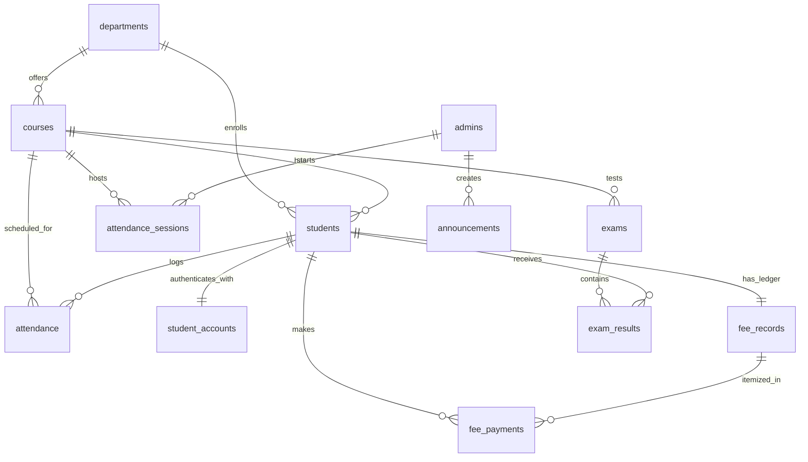

# 🗄️ Student Information System — Database Schema & Architecture

This document describes the schema design, tables, primary/foreign key relationships, and indexes for `student_db`.

---

## 📐 Entity-Relationship Overview

---

## 📋 Table Reference

### 1. `departments`
Stores academic departments.
- `id` (INT, PK, Auto-increment)
- `name` (VARCHAR(100), UNIQUE)
- `code` (VARCHAR(10), UNIQUE)
- `created_at` (TIMESTAMP)

### 2. `courses`
Stores degrees/courses linked to departments.
- `id` (INT, PK, Auto-increment)
- `name` (VARCHAR(150))
- `code` (VARCHAR(20), UNIQUE)
- `department_id` (INT, FK -> `departments.id`)
- `duration_years` (TINYINT)

### 3. `admins`
System administrator accounts.
- `id` (INT, PK, Auto-increment)
- `username` (VARCHAR(50), UNIQUE)
- `email` (VARCHAR(100), UNIQUE)
- `password_hash` (VARCHAR(255), bcrypt)
- `full_name` (VARCHAR(100))
- `last_login` (TIMESTAMP, NULL)

### 4. `students`
Primary student biographical and academic profile.
- `id` (INT, PK, Auto-increment)
- `name` (VARCHAR(100))
- `roll_number` (VARCHAR(20), UNIQUE)
- `email` (VARCHAR(150), UNIQUE)
- `phone` (VARCHAR(15))
- `course_id` (INT, FK -> `courses.id`)
- `department_id` (INT, FK -> `departments.id`)
- `admission_date` (DATE)
- `status` (ENUM('active', 'inactive', 'graduated'))

### 5. `student_accounts`
Authentication credentials for the student portal.
- `id` (INT, PK, Auto-increment)
- `student_id` (INT, UNIQUE, FK -> `students.id` ON DELETE CASCADE)
- `password_hash` (VARCHAR(255), bcrypt)
- `is_active` (BOOLEAN)
- `must_change_password` (BOOLEAN)
- `last_login` (TIMESTAMP, NULL)

### 6. `announcements`
College notifications broadcast to students.
- `id` (INT, PK, Auto-increment)
- `title` (VARCHAR(200))
- `message` (TEXT)
- `target_course_id` (INT, NULL, FK -> `courses.id`)
- `target_department_id` (INT, NULL, FK -> `departments.id`)
- `created_by` (INT, NULL, FK -> `admins.id`)

### 7. `fee_records`
Financial summary ledger per student.
- `id` (INT, PK, Auto-increment)
- `student_id` (INT, UNIQUE, FK -> `students.id` ON DELETE CASCADE)
- `total_fee` (DECIMAL(10,2))
- `paid_amount` (DECIMAL(10,2))
- `remaining_balance` (DECIMAL(10,2))
- `fee_status` (ENUM('Paid', 'Partial', 'Unpaid'))

### 8. `fee_payments`
Individual payment transactions.
- `id` (INT, PK, Auto-increment)
- `fee_record_id` (INT, FK -> `fee_records.id`)
- `student_id` (INT, FK -> `students.id`)
- `amount` (DECIMAL(10,2))
- `payment_date` (DATE)
- `payment_method` (ENUM('Cash', 'Card', 'UPI', 'Net Banking', 'Cheque'))
- `remarks` (VARCHAR(255))

### 9. `attendance`
Daily attendance records per student.
- `id` (INT, PK, Auto-increment)
- `student_id` (INT, FK -> `students.id`)
- `course_id` (INT, FK -> `courses.id`)
- `class_name` (VARCHAR(100))
- `date` (DATE)
- `status` (ENUM('Present', 'Absent'))
- *Constraint:* `UNIQUE KEY (student_id, date)`

### 10. `attendance_sessions`
Temporary sessions for classroom QR code scanning.
- `id` (BIGINT, PK, Auto-increment)
- `course_id` (INT, FK -> `courses.id`)
- `class_name` (VARCHAR(100))
- `token` (VARCHAR(64), UNIQUE)
- `expires_at` (DATETIME)
- `status` (ENUM('open', 'closed'))

### 11. `exams` & 12. `exam_results`
Exam scheduling and gradebook.
- `exams`: `title`, `subject`, `course_id`, `exam_date`, `max_marks`, `pass_marks`, `status`
- `exam_results`: `exam_id`, `student_id`, `marks_obtained`, `status` ('pass'/'fail'/'pending'), `remarks`
